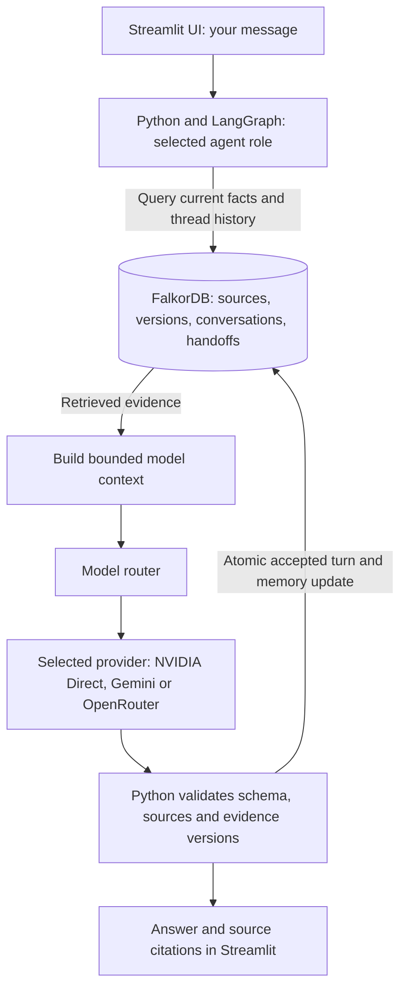
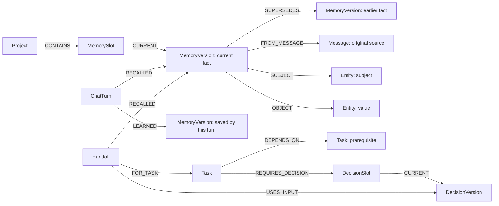
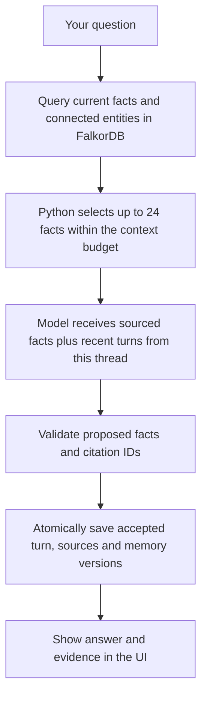

# Continuity

Talk naturally to an assistant that remembers your facts, past events and routines.
FalkorDB stores the original sources, current values, corrections and conversation
history. Planner and Helper share that memory and pass project work between them.

**Track 2: Agent Memory and Coordination.** The working-demo recording steps are
in [DEMO_SCRIPT.md](docs/DEMO_SCRIPT.md). This prototype runs locally; setup is
below. A public demo video link has not yet been added.

## Open the app

```powershell
.\docker.ps1 compose up -d --wait
.\ui.ps1
```

Open **http://localhost:8501**. Start in **AI Assistant Chat** and send a normal
message. Use **New conversation** to check recall without the previous thread's
history. **Memory** shows facts, sources, corrections and a connected graph.

Follow the [short step-by-step demo](docs/DEMO_SCRIPT.md). The graph and answer
flow diagrams are below in this README.
There are no preloaded user facts, fake tasks or scripted live responses. Test
fixtures and live smoke scenarios run in separate temporary graphs.

## Setup on another Windows computer

Install Python 3.13 and Docker Desktop with Linux containers. In this folder:

```powershell
py -3.13 -m venv .venv
.\.venv\Scripts\python.exe -m pip install -r requirements.lock
Copy-Item .env.example .env
```

Set `GOOGLE_API_KEY` and `GOOGLE_MODEL`, or `OPENROUTER_API_KEY`, in the private `.env` file. Do not overwrite
an existing `.env`. This workspace already has an isolated Python and installed
packages under `.tools/python`, so another Python installation is not needed here.

Direct NVIDIA access is also supported: set `NVIDIA_API_KEY` and optionally
`NVIDIA_MODEL=nvidia/nemotron-3.5-super-vl-120b-a12b`, restart the app, then select
**NVIDIA Direct — Nemotron 3.5 Super VL** under **Active Provider**. It uses
NVIDIA's own hosted endpoint, separately from OpenRouter. The router also tries
configured NVIDIA access after Gemini in Auto mode, within the existing request
budget. Actual reported model IDs are retained; endpoint aliases may differ
from the requested model name. No extra Python package is required.

Our local database uses `localhost:6380`, with blank username/password and SSL off.
Docker Desktop login details do not belong in `.env`. The database/browser bind to
localhost. Graph browser: **http://localhost:3000**.

`ui.ps1` and `run.ps1` use `.venv` when present, otherwise `.tools/python`.
`docker.ps1` locates Docker Desktop even when its CLI is not on your terminal PATH.

## Terminal use

Check the connection:

```powershell
.\run.ps1 doctor
```

Plan a new task using your own input, then pass its returned handoff automatically:

```powershell
$myTask = Read-Host 'Describe your actual task'
$plan = .\run.ps1 --project my_project plan $myTask --new-task | ConvertFrom-Json
if ($plan.handoff) { .\run.ps1 --project my_project help $plan.handoff }
.\run.ps1 --project my_project status
.\run.ps1 --project my_project history
```

There is no seed command or demo-answer flag in the live CLI. Commands expose
`--request-id` for safe retries. A replay returns the original receipt; inspect
current status separately. Generating a draft does not complete a task.

## Decisions and completed work

Technical dependencies are explicit. A completed task based on React needs review
when its declared interface decision changes to Streamlit. The old result stays
in history. You explicitly confirm compatibility, reopen the task or replace it.
A source-backed user report is required to record completion. Approval of a
procedure is not evidence that its steps were performed.

## Architecture and code

Open [the recording diagram](docs/architecture.html) in a browser and follow
[its short narration](docs/DEMO_SCRIPT.md#architecture-explanation-about-50-seconds).



Assistant, Planner and Helper are roles that read the same project's memory.
Planner saves a task handoff; Helper reads it and the current evidence. The user
performs the suggested work. Short-term context uses recent turns from the
selected thread; long-term context uses saved project facts across threads.

| File | Job |
|---|---|
| `streamlit_app.py` | Live browser interface |
| `app/conversation.py` | Natural chat, sourced memory proposals, cross-thread context |
| `app/actions.py` | UI/CLI actions with stable request IDs |
| `app/workflow.py` | Explicit LangGraph retrieval, generation and guarded commit |
| `app/models.py` | Gemini/OpenRouter routing, structured output, bounded fallbacks |
| `app/service.py` | Scope, evidence assembly, request replay and three-attempt budget |
| `app/domain.py` | Decision, dependency, review and claim rules |
| `app/repository.py` | FalkorDB graph queries and optimistic guarded commits |

For this small prototype a canonical project snapshot and connected graph records
are committed together. Conversation retrieves current memory and connected entities through graph paths;
Helper also traverses decisions and prerequisites.
The projection is rebuilt per transition, so this design is for small projects.
Stable business IDs remain; internal graph node IDs can change.

## The graph that supplies the agents' memory

These are actual node labels and relationship types from
[`app/repository.py`](app/repository.py). Each tenant has a separate graph;
queries also scope records to a project.



A correction moves `CURRENT` to a new version. The new version links to the old
one with `SUPERSEDES`; both retain their original message sources. A new chat
thread can read the current facts without receiving the previous thread's
conversation history. A saved handoff records the fact and decision versions it
used, so Planner and Helper can share evidence and detect relevant changes.

### How the graph affects an answer



This is the actual parameterized conversation retrieval query:

```cypher
MATCH (p:Project {id:$project})
OPTIONAL MATCH (p)-[:CONTAINS]->(:MemorySlot)-[:CURRENT]->(m:MemoryVersion)
OPTIONAL MATCH (m)-[:SUBJECT|OBJECT]->(entity:Entity)
               <-[:SUBJECT|OBJECT]-(neighbor:MemoryVersion)<-[:CURRENT]-(:MemorySlot)
WHERE neighbor.project=$project
RETURN p.snapshot, collect(DISTINCT m.data), collect(DISTINCT neighbor.data)
```

The application binds `$project`, then uses bounded lexical/entity selection in
`select_memories`. The graph returns current facts and entity-connected facts;
this prototype does not implement vector search or an LLM-generated Cypher query.
The model sees only the selected memory records, with source and version IDs.

An ungrounded memory proposal is skipped with a visible warning; valid facts
and the chat reply can still be saved. Source checks remain enforced for every
accepted fact. Unknown citations or stale evidence still reject the turn.

Helper also reads a task's current decisions and prerequisite paths from the
graph in `task_context`:

```cypher
MATCH (p:Project {id:$project})
MATCH (t:Task {id:$task})
OPTIONAL MATCH (t)-[:REQUIRES_DECISION]->(:DecisionSlot)-[:CURRENT]->(d:DecisionVersion)
WITH p, t, collect(DISTINCT d.data) AS decisions
OPTIONAL MATCH (t)-[:DEPENDS_ON*1..16]->(dep:Task)
RETURN p.snapshot, t.data, decisions, collect(DISTINCT dep.data)
```

`$task` is the application's project-qualified task ID. Python checks claims,
dependencies and evidence versions before accepting a handoff or draft. The
graph supplies the stored evidence; the model writes a suggestion and does not
perform the user's work. See [graph-browser queries](docs/QUERIES.md) to inspect
these records yourself.

Workflow checkpoint recovery remains deferred; saved business requests/handoffs
support fresh-session resumption. No code execution tools, deployment actions,
authentication or independent verification of reported outcomes are implemented.

## Tests and benchmarks

Automated tests use isolated fixtures/model doubles to exercise failures without
filling your live workspace. They do not claim live-model quality.

```powershell
$env:PYTHONNOUSERSITE = '1'
$env:PYTEST_DISABLE_PLUGIN_AUTOLOAD = '1'
$env:CONTINUITY_DB_TESTS = '1'
.\.tools\python\python.exe -m pytest -q
```

The contract evaluation is a developer test command, not a workspace-data source:

```powershell
.\.tools\python\python.exe -m benchmarks.contracts
```

Public dataset evaluation, scoring and comparable runs are described in
[BENCHMARKS.md](docs/BENCHMARKS.md). No official benchmark score or leaderboard placement
has been claimed. Actual verification records: [IMPLEMENTATION_STATUS.md](docs/IMPLEMENTATION_STATUS.md).

For the real LoCoMo pilot, score dashboard and quota-saving resume command, see
[LOCOMO.md](docs/LOCOMO.md). The website's Benchmark page reads actual saved runs;
it labels API/import failures and does not invent a leaderboard score.

## Persistence

Compose pins FalkorDB v4.22.1 by digest, mounts `/data`, and sets
`FALKORDB_DATA_PATH=/data`, AOF enabled and every-second flushing. Verify:

```powershell
.\docker.ps1 compose exec -T falkordb redis-cli CONFIG GET dir appendonly appendfsync
```

Graceful restart and container replacement with the retained volume have been
verified. Every-second flushing allows recent-data loss on hard crashes. Keep the
volume when stopping the service. Example graph reads: [QUERIES.md](docs/QUERIES.md).

## Hackathon disclosure

Intended Track 2 submission; nothing has been submitted or publicly deployed.
Codex assisted with planning, code, tests and documentation. The participant must
understand and adapt the implementation, record a demo and disclose assistance.
