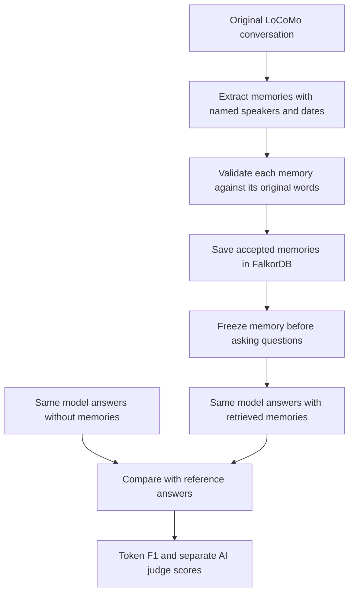

# Test Continuity with LoCoMo

LoCoMo provides long conversations and questions with reference answers. The
test asks whether our agent can answer using memories saved from those
conversations. It uses real model calls and a separate temporary FalkorDB graph.
Your website's project data is not used or changed.



Both methods answer **every selected question**. The no-memory version is a
baseline: it checks whether graph memory adds useful information. Questions,
references and evidence labels are hidden during memory extraction. References
are also hidden from the answering model. Each question starts with no previous
question/answer history. Answering cannot change the frozen memories.

## Where to see results

Open the website's **Benchmark** page and select a saved LoCoMo run. For details,
open its folder under `benchmark-runs`:

- `REPORT.md`: results, errors and limitations in words.
- `dashboard.html`: open in your browser for score cards.
- `answers.csv`: each question, reference, actual answer and score.
- `manifest.json`: exact models, dataset checksum, selected questions and budgets.
- `memory.json`: the actual saved facts and their source messages.
- `ingestion.jsonl`: imported chunks and rejected memory proposals, on fresh imports.

**Token F1** measures answer-word overlap after normalization and stemming. It
does not mean percent of fully correct answers. **Local judge accuracy** asks a
separate model whether the answer means the right thing. Judge failures make
that accuracy unavailable. Answer failures count as zero and stay visible.

Import failures and rejected facts are also reported. A valid API response can
still be a wrong answer. A failed API request is an execution failure, not proof
that the memory system forgot something.

## Run the small pilot

Use the workspace terminal. Install the optional scoring dependency once:

```powershell
$env:PYTHONNOUSERSITE='1'
.\.tools\python\python.exe -m pip install -r benchmarks/requirements-locomo.txt
```

The official dataset is already downloaded at `benchmark-data/locomo10.json`.
The frozen original import is available in
`benchmark-runs/locomo-cohere-pilot-20261018`. Reuse it to save API requests:

```powershell
.\.tools\python\python.exe -m benchmarks.locomo --dataset benchmark-data/locomo10.json --out benchmark-runs/locomo-my-resume --resume-from benchmark-runs/locomo-cohere-pilot-20261018 --sample-index 0 --per-category 2 --model gemini-3.5-flash-lite --judge-model gemini-3.5-flash --max-calls 22 --minutes 18 --workers 1
.\.tools\python\python.exe -m benchmarks.locomo_report --run benchmark-runs/locomo-my-resume
```

Choose an unused output folder each time. Models must be available with quota
on your account. Keys remain in `.env`. The resume command verifies the dataset
and question selection, checks source grounding, and restores only into a new,
empty benchmark graph. It preserves the original extraction limitations; it
does not fill missing memories from the reference answers.

For NVIDIA's own API, use the prefix `nim:` for either `--model` or
`--judge-model`, for example
`nim:nvidia/nemotron-3.5-super-vl-120b-a12b`. This reads `NVIDIA_API_KEY` and calls
NVIDIA directly. Without that prefix, names containing `/` use OpenRouter.
Reader and judge remain fixed for each experiment; changing the provider does
not make an old score a new NVIDIA score. The connection smoke check is not a
LoCoMo evaluation. Check available quota before launching a larger run.

`--per-category 2` selects the first two questions from each of categories 1-4:
**8 questions per method**. Category 5 (adversarial) is excluded and disclosed.
This needs 16 answering calls and up to 4 judge calls, with no import calls.
Fixed model IDs, no fallback and no automatic retries keep the experiment
auditable. A daily-quota failure stops further provider dispatches.

For a fresh import, omit `--resume-from` and use a new output folder. The first
conversation needs 19 extraction calls before answering. With this eight-question
selection, allow about **39 total calls** (19 import + 16 answer + 4 judge).
Free-model quotas may be too small; use the saved import when time is limited.

## What you can claim

This is a **small local pilot of a transcript-import extension plus Continuity's
production graph retrieval**. The website normally receives one user message
at a time; the import extension handles two speakers in batches. It shares the
app's memory schema, source checks, versioning and FalkorDB graph projection.
Images and supplied image captions are excluded.

The extraction model and answering model may differ on resumed runs; both are
named in the report. Quality depends on extraction, retrieval and answering.
The initial import kept only part of the proposed memories, so sparse memory
coverage can limit scores even when answering calls succeed.

An eight-question pilot is not the complete benchmark, a global leaderboard
entry, or a reproduction of Mem0's published score. Never compare the numbers
as if the datasets, readers, judges and settings were identical. Full evaluation
requires more conversations, questions, quota and a fixed documented protocol.

Sources: [original LoCoMo](https://github.com/snap-research/locomo),
[original scoring code](https://github.com/snap-research/locomo/blob/main/task_eval/evaluation.py),
[Mem0 research](https://mem0.ai/research).
