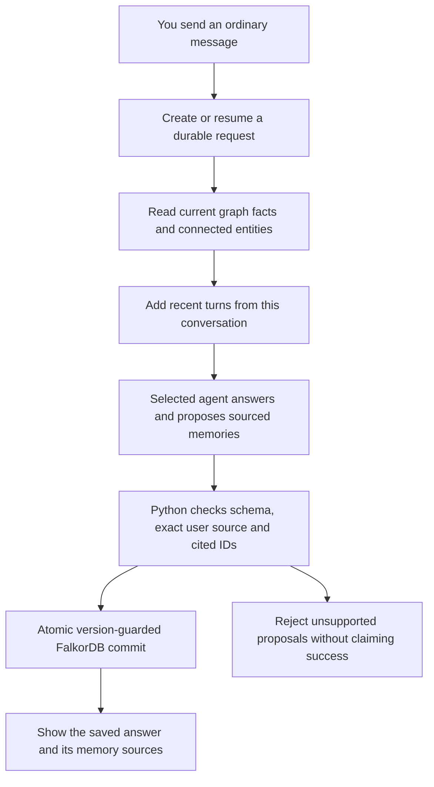
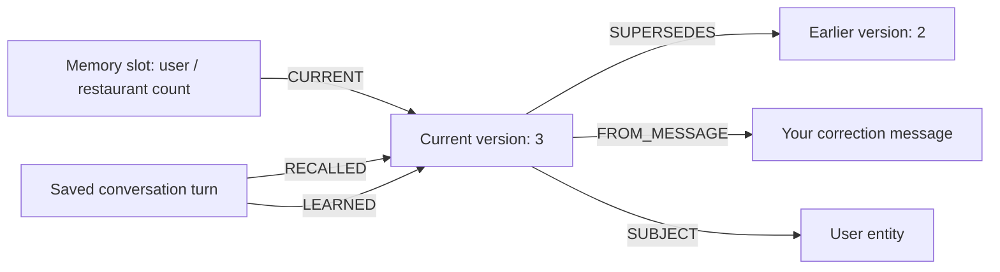
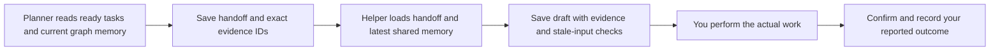

# Continuity: conversations that survive a restart

Track 2: Agent Memory and Coordination. Updated 18 October 2026.

You can talk normally. Continuity saves useful user facts, experiences and
routines in FalkorDB with the original message. Assistant, Planner and Helper
share those memories. New conversations keep them; corrections preserve history.

## What each part does

| Part | Job |
|---|---|
| Streamlit | Chat, conversation selector, memory graph, task board |
| Gemini / OpenRouter | Answer, propose memories, select tasks and suggest steps |
| LangChain | Gemini model integration and structured output |
| LangGraph | Conversation and Planner/Helper workflows |
| Python/Pydantic | Validate proposals, sources, scope and allowed state changes |
| FalkorDB | Primary persistent graph, source messages, current facts, history, handoffs |
| Docker volume + AOF | Keep the database across ordinary process/container restarts |

GraphRAG SDK is not used. This application has a custom agent-memory graph,
rather than a document-ingestion RAG pipeline.

## Conversation architecture

Short-term context: the most recent eight complete turns, under a size budget.
Long-term context: current sourced facts and related entities, retrieved from
FalkorDB across conversations. The full successful conversation log is durable;
it is not all sent back to the model on every call. UI displays the last 40 turns
of a selected conversation. Saved conversations stay selectable after reload.

## Memory graph

- Semantic: user facts, named entities, preferences and relationships.
- Episodic: user-reported events, appended with source and recorded time.
- Procedural: explicit reusable user routines/preferences. These are distinct
  from task procedures, whose executable-looking steps need explicit approval.
- Single-valued facts update one slot; explicitly referenced corrections replace
  that slot's value. Many-valued relations keep separate named objects.
- Facts remain user assertions, not independently verified truths.
- Assistant text and questions cannot be used as asserted user-memory sources.

## Coordination

A correction between agents is visible to Helper. A relevant fact changing
while a draft is generated makes that draft stale. Technical decisions and
prerequisites have explicit completion/review rules. General conversational
facts are advisory context: changing one does not automatically reopen every
previously completed task.

## Persistence, concurrency and scope

Each local profile has a tenant graph; projects are scoped within it. Conversation
threads share their project's memory, not other projects' memory. The profile
selector is not authentication; keep this local deployment on localhost.

Every provider attempt reserves a persistent slot (maximum three per request).
Stable request IDs replay accepted output without another logical write. Database
compare-and-set guards avoid lost updates. Concurrent unrelated memory writes
can merge; competing corrections are rejected for a fresh request.

The prototype rebuilds a small project's graph projection with its canonical
snapshot per commit. This is auditable and tested for correctness, not proven
high-throughput production architecture. Retrieval is lexical plus entity
connections with bounded context, not vector search or unlimited recall.
