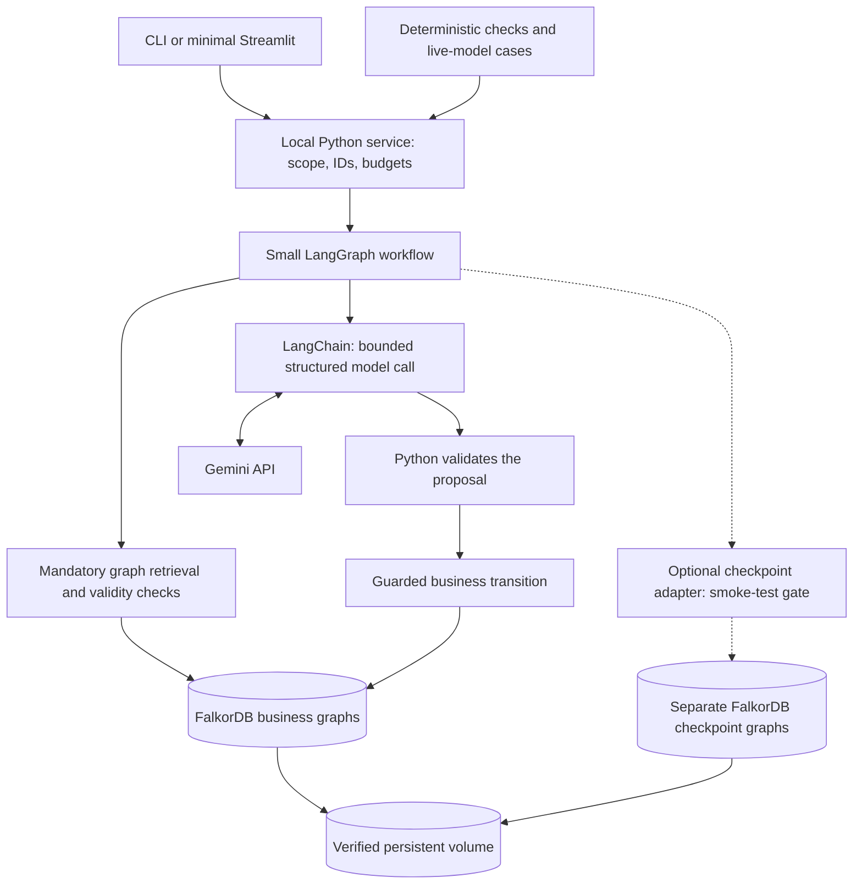
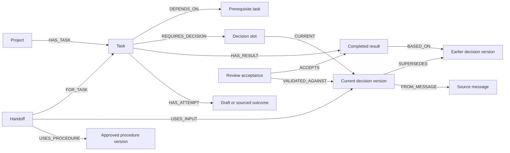
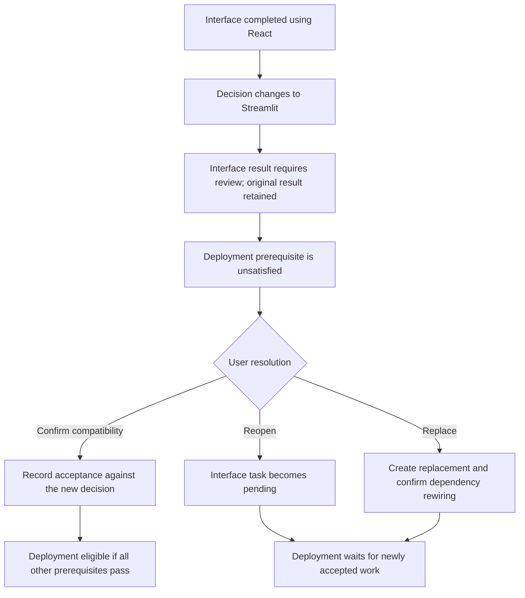
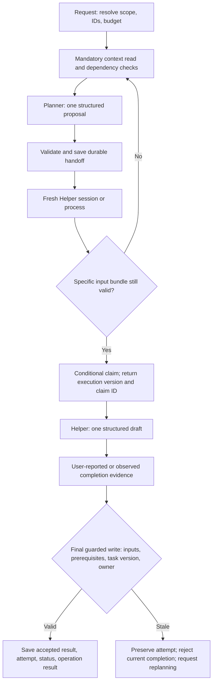

# Continuity: resume project work from a valid next step

Revised specification: 18 October 2026. **Streamlit and core checks implemented; public benchmarking pending.**
See [event facts](HACKATHON_BRIEF.md) and [evaluation](EVALUATION_PLAN.md).
See [implementation status](IMPLEMENTATION_STATUS.md) and [run instructions](README.md).

## Product promise and honest differentiation

A Planner and Helper remember why work was chosen, detect the impact of changed
decisions, and resume from a valid next step. FalkorDB stores decisions, their
sources/history, prior attempts, approved procedures, prerequisites, and durable
handoffs. Both roles can use the same Gemini model.

Existing work already covers important parts of this space:

| Related work | Existing capability |
|---|---|
| [FalkorDB/Mem0-Demo](https://github.com/FalkorDB/Mem0-Demo) | Persistent graph memory for coding assistants |
| [Graphiti](https://github.com/getzep/graphiti) | Temporal knowledge graphs for agent memory |
| [Letta Code](https://github.com/letta-ai/letta-code) | Stateful coding agents with persistent memory |
| [LangMem](https://github.com/langchain-ai/langmem) | Memory extraction, consolidation, and memory-management primitives |

Our proposed difference is application-specific: check task validity against
explicit decisions and prerequisites, retain evidence, explain decision impact,
and resume a handoff without silently accepting stale work. This is not a new
memory algorithm, and no superiority or novelty result is claimed.
[Skyframe](https://bazel.build/reference/skyframe) is an engineering reference for
explicit dependency tracking, not a component we will install or a measured comparison.

## Submission scope

Use synthetic users A/B, two small projects, roughly 4-6 tasks per project, one
approved procedure, and a few sourced attempts. Keep project decisions separate
for each user/project. No global user-preference inheritance is required initially.

Retain current decisions and corrections; prerequisite checks; review of completed
work affected by decisions; a saved Planner handoff resumed by Helper in a fresh
process/session; conditional claims; stale-result rejection; idempotent retry;
evidence display; and a reproducible persistent local setup.

Defer automatic claim expiry/reassignment, multi-process workers, a general memory
platform, broad free-form recall, embeddings, full benchmark ingestion, and load
campaigns. A separate HTTP service and sophisticated UI are not required.

## Stack and architecture

| Part | First choice and purpose |
|---|---|
| Python | 3.13 for a fresh installation; 3.12 is also a candidate, subject to dependency smoke tests |
| LangChain + Gemini integration | Bounded model calls and structured responses |
| Small explicit LangGraph workflow | Retrieval, proposal, validation, planning/helping, and commit steps |
| FalkorDB Python client | Named parameterized queries for every read and business transition |
| Pydantic | Typed decisions, outputs, evidence references, and commands |
| Interface | CLI plus implemented local Streamlit interface |
| Service layer | Ordinary Python services in the same local process |
| Docker Compose | FalkorDB with a verified data volume and AOF persistence |
| pytest | Deterministic database checks and a few controlled race tests |
| Optional checkpoint adapter | FalkorDBSaver, only after the compatibility/restart gate passes |

FastAPI/Uvicorn can be added later if a real boundary is needed; neither is
currently implemented. GraphRAG SDK, Mem0, Graphiti, LangMem, MCP, and a separate
vector store are not dependencies of the first submission.



One local process owns the service layer. Serialize calls for one conversation
using service-owned locks; do not mistake those locks for database durability or
multi-process coordination. The model cannot select tenants, projects, graph names,
operation IDs, arbitrary Cypher, or an unowned thread. The service validates every
referenced ID in its selected user/project. The synthetic selector is not real
authentication; public personalized deployment needs an authenticated identity boundary.

## Small data and write policy

Start with explicit project-scoped fields:

| Key | Type | Use |
|---|---|---|
| interface_framework | Allowed framework enum, initially React/Streamlit | Implementation input for declared interface tasks |
| database_engine | Small configured enum | Implementation input for declared database tasks |
| response_style | Short/simple or another allowed style | Response formatting; not a technical task dependency |

The model proposes a typed change with an exact source passage and source-message
ID. Python verifies the schema, permitted key/value, scope, and passage membership.
An assistant suggestion or speculative statement is not an accepted user decision.
Unclear wording such as "maybe use Streamlit" requires confirmation. A no-op
assertion does not create a technical decision change.

Distinguish provenance explicitly:

- User assertion: the user supplied the decision/fact; not independently verified.
- Assistant suggestion/draft: a proposal, never proof of user acceptance or execution.
- Observed outcome: supported by an actual recorded check or execution artifact.
- User-reported outcome: supplied by the user and labeled accordingly.

A procedure records its source, trigger, ordered steps, version, and approval.
Approval permits using the procedure; it does not prove its steps were executed.
Keep immutable decision versions and their sources. Support immediate corrections
and ordered recorded history. General late/backdated reconciliation and
future-effective scheduling are deferred; clarify rather than invent a resolution.

## Graph and dependency contracts



`REQUIRES_DECISION` declares a task's implementation inputs in this small domain.
These declarations come from fixtures or explicit user choices. The LLM is not
required to discover every possible dependency.

`Result -[:BASED_ON]-> DecisionVersion` records which exact decisions supported
that result when accepted. Those links are historical and do not change when a
new decision is created. Task prerequisites, results, and decisions stay in the
same user business graph so a business transition can use one conditional query.
Reject prerequisite cycles and references outside the selected project.

Core records:

| Record | Required contract |
|---|---|
| Project | ID, read watermark `revision` |
| Message | Stable ID, speaker, source type, raw synthetic text, recorded time |
| DecisionSlot / DecisionVersion | Scoped key, slot version, one current version, typed value, source passage |
| Procedure | Versioned approved steps and source |
| Task | Status, business version, declared inputs, prerequisites, accepted-result reference |
| Result | Original input versions, outcome provenance, review state; original content retained |
| Attempt | Draft/action/outcome, provenance, evidence, and stale/noncurrent status |
| Review | User's resolution, source, result, and decision versions checked |
| Handoff | Objective, task, evidence and dependency bundle, status, claim identity |
| Request / Operation | Stable identity, accepted command envelope, payload hash, committed result |

A task version changes on its status, accepted-result/review validity, or declared
dependency changes. Merely appending a message does not change its version.
Index stable IDs and scoped keys, and validate actual server constraint behavior.

### Completed work after a decision changes

When an implementation decision changes, use the explicit dependency links to
identify results that relied on the earlier effective version. In the same
business transition, retain history and mark those directly affected results
`requires_review`; bump the affected task versions. Do not call those results
technically wrong or automatically reopen every dependent task.

A prerequisite is satisfied only if it has an accepted completed result whose
review is valid, whose relevant decision coverage is current, and whose own
prerequisites are satisfied. A prerequisite requiring review is unsatisfied.
Blocking propagates through eligibility; judgments that work is technically wrong
do not automatically propagate.

The user chooses one explicit resolution:

1. Confirm the existing result remains valid: append a review acceptance linked
   to the new decision version and its source. Preserve the original BASED_ON
   links; record the compatibility judgment rather than claiming a rebuild occurred.
2. Reopen the work: make the task pending, preserve the previous result, clear its
   active completion, and change its version.
3. Create replacement work: link the new task to the old one and explicitly confirm
   which prerequisite edges are rewired. Preserve the original result and history.

A later relevant decision change checks the result's effective review coverage
again. A response-style change does not mark interface/database results for review,
provided those tasks have no declared implementation dependency on that field.



## Read consistency is different from business validity

`project.revision` is a monotonically increasing **read watermark**, incremented
once in a successful business transition that changes visible project context.
It is not a blanket handoff-invalidity flag.

| Mutation | Watermark changes? |
|---|---|
| Accepted current decision or approved procedure changes | Yes |
| Task status/input/prerequisite/result-review change | Yes |
| Handoff save, claim, status change; accepted attempt/outcome record | Yes |
| New source/chat message alone | No: messages are archived, not general recall candidates in this first scope |
| Checkpoint, metrics, or operation receipt alone | No additional increment |
| Replayed operation returning its old result | No |

For several context reads, read revision before and after and retry if it changed
*during assembly*. Prefer one combined read when practical. A later revision
change merely says something changed; inspect the particular dependencies.

The handoff's small business dependency bundle contains:

- Its task ID and planning task version.
- Exact implementation decision slot/version IDs it uses.
- Current approved procedure version IDs it uses.
- Prerequisite task versions and accepted-result/review references.

Response-only preferences and cited background attempts are evidence, not automatic
technical invalidators. If an episode establishes a blocker, encode that blocker
explicitly in task state or a declared input instead of relying on prose.

A handoff is invalid when one of its declared inputs, relevant procedure approvals,
prerequisite validity, or expected task state changes. An unrelated message, an
independent task's outcome, or a presentation preference does not force replanning.
Independent outcomes can bump the read watermark without invalidating this bundle.

Saving a handoff does not change its task/input versions. Claiming changes the
owner/status and task version atomically and returns a new execution task version.
The completion guard uses that returned version and claim identity, while the
original planning snapshot remains history. Neither operation compares its old
global revision to its own new watermark, so it does not invalidate itself.

## Workflow, final commit, and checkpoint replay

Mandatory retrieval and validity checks are Python workflow steps. Model outputs
are bounded schemas, not open-ended tool loops. The Planner selects only from the
eligible task IDs supplied by code; the Helper drafts steps using validated evidence.



The final completion query must check the expected execution task version, claim
identity/owner, current relevant decision/procedure versions, and the prerequisite
versions and current validity. Do this at the **final state-changing commit**,
not only at handoff load or claim. Version checks and mutation belong in one
conditional FalkorDB query.

If inputs change while the Helper is generating, preserve its draft as a stale
attempt but do not publish an accepted completion. Record the rejection/result
idempotently; release only a claim still owned by that operation if returning the
task to pending. Never clear a newer owner's claim. Missing completion evidence
also prevents promotion of a draft into completed work.

Every generation/action node, including a resumed node, refreshes or validates
its stored evidence before use. A resumed workflow may skip START, so a check only
at entry is insufficient. The final guard checks again to close changes occurring
after that preflight. No external write actions are in scope.

Claims do not expire or reassign automatically in the first build. After a restart,
resume the recorded claim, or use an explicit user-confirmed release that changes
task version. An old claim then fails completion. Automatic expiry, fencing-based
reassignment, and distributed workers are deferred.

### Checkpoint smoke-test gate

The [official integration](https://github.com/FalkorDB/langchain-falkordb) describes
FalkorDBSaver. Verify the installed package with pinned LangGraph/checkpoint
versions: save, stop the application, restore with the same thread, and confirm
separate tenants/threads cannot see each other's state.

If this fails, keep durable decisions, sources, and handoffs in FalkorDB and show
resumption through a **fresh conversation**. Explicitly defer arbitrary workflow
checkpoint restoration. In-memory checkpoints disappear on process exit.
Checkpoint graphs are separate from the public business graph; their writes are
not atomic with business transitions. Replayed business operations must be idempotent.

## Precise identity, idempotency, and writes

Scope an operation by `(tenant, project, operation_type, operation_id)`. Store a
SHA-256 hash of its normalized accepted payload and its committed structured result.
Normalization uses typed values and canonical JSON with sorted keys; source passages
remain exact. Include expected input versions and claim data in the accepted envelope.

- Same scoped ID and same payload hash: return the original result without another effect.
- Same scoped ID and a different payload hash: explicit idempotency conflict; no mutation.
- A version conflict is not permission to silently change that envelope. A revised
  command gets a new service-controlled operation ID after revalidation/confirmation.

The UI/CLI generates and retains a request ID before dispatch; the service records
it and derives the source message ID from that request and scope. Before executing
accepted model proposals, persist their normalized command envelopes and operation
IDs in the request record. Derive IDs from request ID, workflow stage, and fixed
operation ordinal. On lost response/checkpoint replay, reload that accepted envelope
and IDs instead of asking the model to regenerate them. A restarted client can select
an existing request to resume; a new natural-language submission is a new request,
not guaranteed semantic deduplication. The model never chooses identity or scope.
The request itself also stores an input hash: reusing its scoped ID with a different
message or role is a conflict before generation. Replayed success is an original
receipt; refresh live task state rather than describing that receipt as a new action.

For each business transition, one conditional write checks its guards, performs
its mutations, increments applicable versions/watermark, and records the operation
result. Check for an existing operation and matching hash within that transition;
lookup followed by an unguarded write is insufficient. Request/source archival is
separate and replay-safe. Failed transitions must not be described as saved.

Single-query behavior is documented by
[FalkorDB](https://docs.falkordb.com/design/concurrency) but must be checked on the
pinned server. Do not claim multi-query rollback, cross-graph atomicity, or exactly-once
external side effects. Two small direct-service race checks are sufficient initially;
a broad throughput claim is not a submission requirement.

## Model, retrieval, and delivery budgets

Database reads, eligibility, version comparisons, decision impact, metrics, and
state transitions use zero model calls. Planning/helping targets **one generation
call**. An extraction or repair call is allowed only when needed.

Proposed hard ceiling: **three provider attempts total per user request**, including
retries across all model steps. The wrapper disables hidden SDK retries or routes
them through that shared counter. One extraction plus generation plus repair already
uses the budget; a failed call also consumes an attempt. Stop truthfully when spent.
Record settings, token usage, and call counts; inspect the actual Gemini API project's
model-specific quotas before choosing rate limits. Those quotas are not verified yet.

Use deterministic project/task retrieval and a small evidence bundle. Preserve all
required inputs within the configured context ceiling; clarify if they do not fit.
No broad semantic-recall guarantee is made. Add embeddings only if a measured
paraphrase failure blocks the chosen scenario.

Use local Docker persistence or a verified persistent deployment. Check the actual
data directory and volume. Every-second AOF flushing leaves a recent-data hard-crash
loss window; graceful restart is a narrower test. Do not rely on
[Cloud Free](https://docs.falkordb.com/cloud/free-tier) for durability.

## Working vertical slices and status

The rows below remain target exit gates. Core code and deterministic tests now
exist; real FalkorDB contract checks and graceful restart have now passed.
The user demonstrated live Planner/Helper output. One synthetic conversation-QA
pilot also completed live; no complete public-dataset score has been measured.
See [implementation status](IMPLEMENTATION_STATUS.md) for actual executed checks.
Rule tests using the RAM adapter do not verify server behavior or persistence.

| Slice | Observable result and exit check |
|---|---|
| 1 | Persistent scoped decision: save, restart, retrieve; retain source/history after correction |
| 2 | Valid next task: prerequisite query and explicit decision/result dependencies; React-to-Streamlit review fixture |
| 3 | Durable handoff: Planner writes it; fresh Helper resumes it; unrelated changes stay valid |
| 4 | Safe completion: conditional claim, changed-input rejection, replay/hash-conflict checks |
| 5 | Minimal interface/evidence plus a few live-model checks and measured request budgets |
| 6 | README, graph/query explanations, assistant disclosure, demo, reproducible setup, submission |

Run the checkpoint compatibility gate early with a short timebox; it cannot block
business-handoff resumption indefinitely. Reserve at least 45-60 minutes for the
submission package before the advertised deadline. Reduce polish before core
correctness. External benchmarks and load campaigns remain off the critical path.

Original suggested layout (the actual files are documented in README):

```text
app/service.py          # scope, request envelopes, budgets
app/workflow.py         # explicit LangGraph steps and revalidation
app/models.py           # bounded generation/extraction
app/memory.py           # typed versions and provenance
app/tasks.py            # validity, impact review, handoffs, guarded completion
app/repository.py       # named parameterized queries
app/cli.py              # minimal local interface
app/checkpoints.py      # optional adapter behind the compatibility gate
tests/                  # submission-critical deterministic and live checks
compose.yaml
README.md
```

## Revision change log

- Sharpened resumption around decision impact, evidence, and valid next work; cited related work.
- Added explicit result-to-decision dependencies and user-controlled impact review.
- Separated read watermarks from precise handoff/commit validity bundles.
- Closed changes-during-generation and checkpoint-replay gaps.
- Defined scoped idempotency with payload hashes and stable replay identities.
- Reduced to one local process, typed writes, bounded model calls, and vertical slices.
- Made checkpoints conditional and moved leases, broad recall, full benchmarks, and load campaigns later.
- At the planning revision, kept application features proposed without claiming test results.
- Implementation now uses a canonical per-project snapshot plus connected graph records,
  guarded by an internal storage version in one Cypher query. This simplifies the tiny
  prototype; it rebuilds the projection per transition and requires real-server validation.
- Helper uses actual graph paths for connected evidence; Python evaluates task validity.
- Local Docker host port is 6380 to avoid a non-FalkorDB service on 6379.
- Arbitrary LangGraph checkpoint restoration remains deferred; business handoffs are the fallback.
- Added Streamlit, isolated contract-check reporting, and a separate experimental
  raw-conversation benchmark adapter. This expands evaluation scope without
  changing the task controller's typed decision rules. See BENCHMARKS.md.
